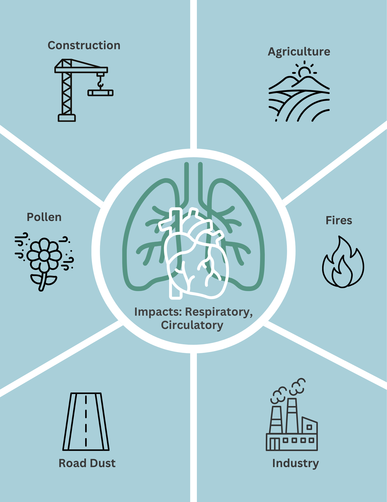
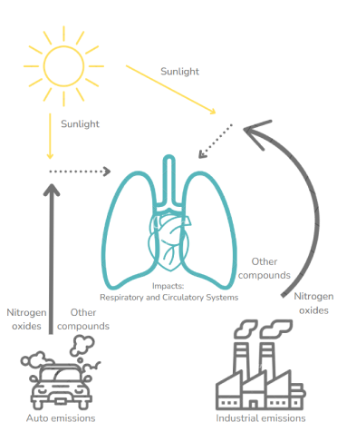
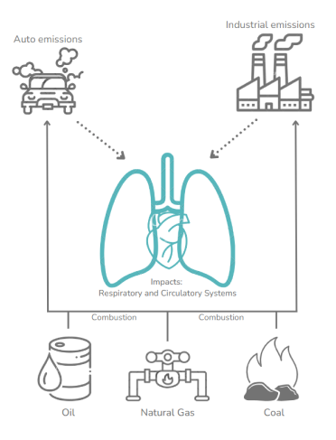
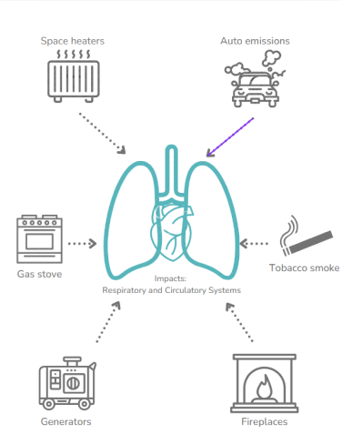
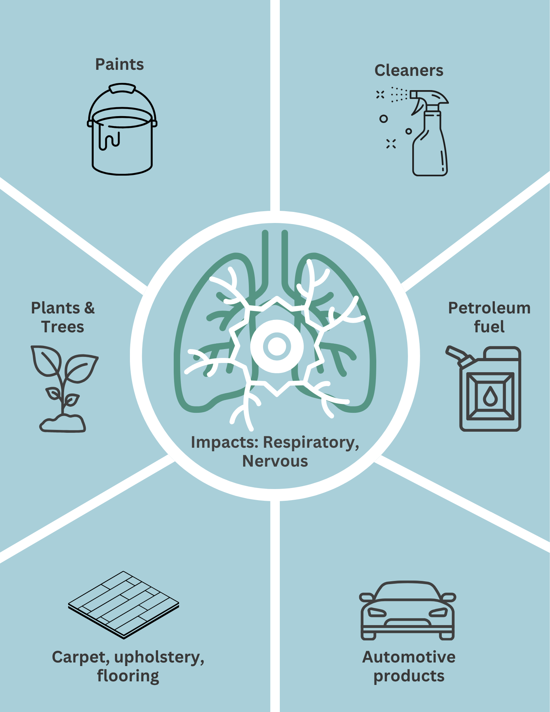
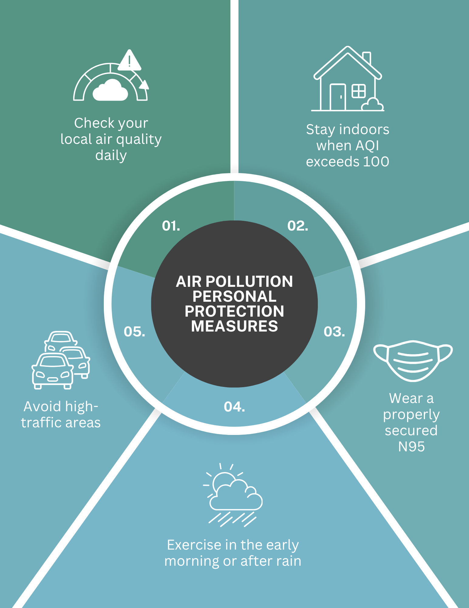
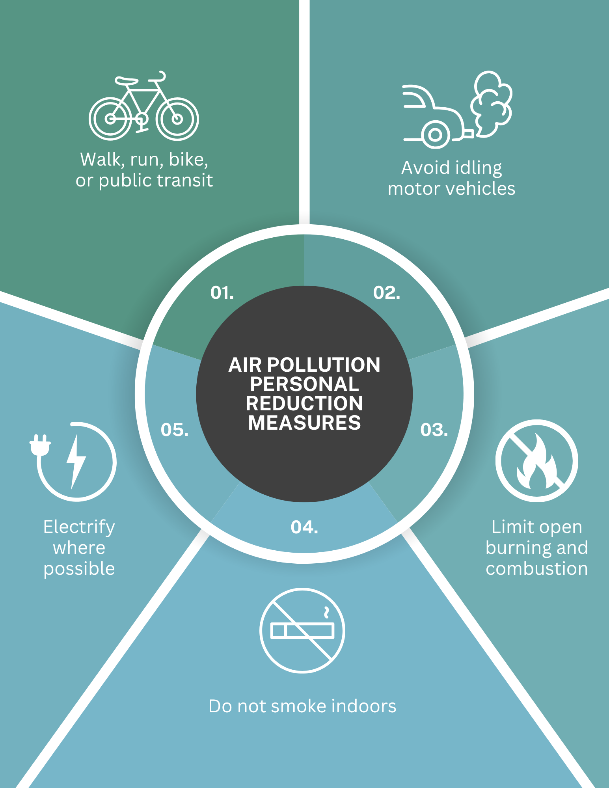

```html
<link href="https://fonts.googleapis.com/css2?family=Roboto:wght@400;500;700&display=swap" rel="stylesheet">
<link href="https://fonts.googleapis.com/css2?family=Aleo:wght@400;500;700&display=swap" rel="stylesheet">
```

```html
<style>
.observablehq h2 {
  background: #669bbc;
  font-family: Helvetica;
  color: white;
  font-size: 22px;
  font-weight: normal;
}
.observablehq h3 {
  font-family: Helvetica;
  color: #333;
}
#observablehq-main {
  padding-left: 80px;
  padding-right: 80px;
  margin-top: 70px;
}
body {
  background: #F7FAFA; 
}

.section-divider {
  display:flex; 
  align-items:center; 
  justify-content:space-between; 
  position:relative; left:50%; 
  transform:translateX(-50%); 
  width:100vw; 
  padding:10px 120px; 
  margin: 60px 0 0px; 
  background:#669bbc; 
  box-sizing:border-box;
}
.site-header {
  position: fixed;
  top: 0;
  left: 0;
  width: 100%;
  height: 47px;
  background: #ffffff;
  font-family: Helvetica;
  color: #5CB6BC;
  display: flex;
  align-items: center;
  justify-content: space-between;
  padding: 0 120px;
  font-size: 22px;
  font-weight: normal;
  box-shadow: 0 2px 8px rgba(0,0,0,0.08);
  z-index: 1000;
  box-sizing: border-box;
  white-space: nowrap;
}

.site-header nav {
  display: flex;
  gap: 24px;
}
.site-header nav a {
  color: #5CB6BC;
  text-decoration: none;
  font-family: Verdana, sans-serif;
  font-size: 14px;
  cursor: pointer;
  white-space: nowrap;
}
.site-header nav a:hover {
  color: #bfbfbf;
}
</style>
```
<div class="site-header">
  <span>Austin Air Quality</span>
  <nav>
    <a onclick="Array.from(document.querySelectorAll('span')).find(s => s.textContent.trim() === 'Select current pollutant levels to display:')?.scrollIntoView({ behavior: 'smooth' })">Map
    </a>
    <a onclick="Array.from(document.querySelectorAll('h2')).find(h => h.textContent.trim() === 'Historic Sensor Data')?.scrollIntoView({ behavior: 'smooth' })">Historic Sensor Data
    </a>
    <a onclick="Array.from(document.querySelectorAll('h2')).find(h => h.textContent.trim() === 'Air Quality Index')?.scrollIntoView({ behavior: 'smooth' })">Air Quality Index
    </a>
    <a onclick="Array.from(document.querySelectorAll('h2')).find(h => h.textContent.trim() === 'Pollutant Information')?.scrollIntoView({ behavior: 'smooth' })">Pollutants
    </a>
    <a onclick="Array.from(document.querySelectorAll('h2')).find(h => h.textContent.trim() === 'Health and Safety')?.scrollIntoView({ behavior: 'smooth' })">Health & Safety
    </a>
    <a onclick="Array.from(document.querySelectorAll('h2')).find(h => h.textContent.trim() === 'About')?.scrollIntoView({ behavior: 'smooth' })">About</a>
  </nav>
</div>

```html
<style>
.pollutant-buttons,
.aqi-buttons,
.location-buttons {
  margin-bottom: 20px;
}
.ehs-buttons button{
  background:#d9d9d9; 
  margin: 5px;
  padding:10px 15px; 
  border-radius:100px; 
  font-family:Verdana; 
  font-weight:normal; 
  color:black; 
  cursor:pointer; 
  border:none; 
  white-space:nowrap; 
  display:flex; 
  align-items:center; 
  gap:5px;
}
.pollutant-buttons button,
.aqi-buttons button,
.location-buttons button{
  margin: 5px;
  padding: 8px 14px;
  border: none;
  background-color: #d9d9d9;
  color: black;
  border-radius: 4px;
  cursor: pointer;
}
.pollutant-buttons button.active,
.aqi-buttons button.active,
.location-buttons button.active,
.ehs-buttons button.active {
  background-color: #A9CFD9;
  color: white;
}
.pollutant-buttons button:hover,
.aqi-buttons button:hover,
.location-buttons button:hover,
.ehs-buttons button:hover {
  background-color: #bfbfbf;
}
.pollutant-content {
  display: none;
  padding: 15px 60px;
  margin: 0 0px;
  background: #ffffff;
  border-radius: 0px;
}
.pollutant-content.active{
  display: block;
}
.pollutant-layout {
  display: flex;
  gap: 30px;
  align-items: flex-start;
}
.pollutant-text {
  flex: 2;
  font-family: 'Verdana', sans-serif;
}
.pollutant-image {
  flex: 1;
}
.pollutant-image img {
  width: 100%;
  max-width: 350px;
  border-radius:10px;
}
.aqi-content {
  font-family: Verdana;
  padding: 10px 120px;
  margin: 0 -120px;
  background: #e3eff3;
  border-radius: 0px;
}
.ehs-content {
  display: none;
  padding: 15px 60px;
  margin: 0 0px;
  background: #ffffff;
  border-radius: 0px;
}
.ehs-content.active{
  display: block;
}

.ehs-row{
  display:flex;
  align-items:flex-start;
  gap:30px;
}

.ehs-text{
  flex:2;
}

.ehs-image{
  flex:1;
}

.ehs-image img{
  width:100%;
  border-radius:10px;
}
</style>
```
```html
<style>
.aqi-table {
  border-collapse: collapse;
  display:table;
  width: 100%;
  margin-top: 20px;
  font-family: Verdana, sans-serif;
  table-layout: fixed;
}
.aqi-table th {
  background-color: #c7c7c7;
  color:white;
  padding: 10px;
  text-align: left;
}
.aqi-table td {
  padding: 10px;
  border-bottom: 1px solid #d9d9d9;
}
.aqi-table tr:hover {
  background-color: #e6f4f5;
}
.aqi-green td {
  color: black;
  background-color: #00e400;
}

.aqi-yellow td {
  color: black;
  background-color: #ffff00;
}
.aqi-orange td {
  color: white;
  background-color: #ff7e00;
}

.aqi-red td {
  color: white;
  background-color: #ff0000;
}
.aqi-purple td {
  color: white;
  background-color: #8f3f97;
}

.aqi-maroon td {
  color: white;
  background-color: #7e0023;
}
</style>
```

```js
// Import shared modules
import { fetchSensorData } from "./lib/data.js";
import { pollutantConfig, MAPBOX_CONFIG } from "./lib/config.js";
import {
  calculateAQI,
  getColorAndCategory,
  calculateAverages,
  safeCalculateAQI
} from "./lib/utils.js";
import { getHighPollutantAlerts } from "./lib/alerts.js";
import {
  initializeMap,
  updateMarkers,
  createAlertsControl,
  showAlertsPanel,
  createSensorPanelContent
} from "./lib/map.js";
import Papa from 'npm:papaparse';
import _ from 'npm:lodash';
import mapboxgl from 'npm:mapbox-gl';

// Fetch sensor data
const sensors = await fetchSensorData();

// Calculate averages
const { avgPM25, avgPM10, avgCO, avgNO2, avgO3, avgVOC, avgAQI } = calculateAverages(sensors);
```
```js
// Display current high pollutant alerts
display(html`
  <div class="grid grid-cols-1">
    <div class="card">
      <h3 style="margin: 0 0 10px 0; font-size: 16px; font-family: Verdana; color: #c76870">
        Current High Pollutant Alerts
      </h3>
      <div id="alerts-container" style="max-height: 400px; overflow-y: auto;">
        ${(() => {
          const currentAlerts = getHighPollutantAlerts(sensors);

          if (currentAlerts.length === 0) {
            return html`<p style="text-align: center; color: #666; padding: 20px;">No sensors currently reporting high pollutant levels</p>`;
          }

          return html`
            <div style="display: flex; flex-wrap: wrap; gap: 10px;">
              ${currentAlerts.map(alert => html`
                <div style="
                  flex: 0 1 calc(12.5% - 10px);
                  min-width: 200px;
                  border-left: 4px solid #c76870;
                  padding: 10px;
                  background: #fee2e2;
                ">
                  <div style="font-weight: bold; margin-bottom: 5px; font-size: 12px;">${alert.sensorName}</div>
                  ${alert.alerts.map(a => html`
                    <div style="margin-left: 10px; font-size: 11px;">
                      ${a.pollutant}: <strong>${a.value} ${a.unit}</strong>
                    </div>
                  `)}
                  <div style="font-size: 10px; color: #666; margin-top: 5px;">
                    Last updated: ${alert.lastUpdate.toLocaleString()}
                  </div>
                </div>
              `)}
            </div>
          `;
        })()}
      </div>
    </div>
  </div>
`);
```
```html
<div style="margin-top:50px; display: flex; flex-wrap: wrap; gap: 15px; align-items: center;">
  <div style="
    background: #d9d9d9;
    padding: 20px;
    border-radius: 8px 8px 0px 0px;
    font-family: Verdana;
    font-weight: bold;
    display: flex;
    align-items: center;
    gap: 10px;
    min-width: 300px;
  ">
    <span>Select current pollutant levels to display:</span>
    <select id="pollutant-select" style="
      padding: 5px;
      border-radius: 4px;
      margin-left: 5px;
      font-family: 'Verdana', sans-serif;
    ">
      <option value="aqi">AQI</option>
      <option value="pm25">PM<sub>2.5</sub></option>
      <option value="pm10">PM<sub>10</sub></option>
      <option value="co">CO</option>
      <option value="no2">NO<sub>2</sub></option>
      <option value="o3">O<sub>3</sub></option>
      <option value="voc">VOC</option>
    </select>
  </div>

  <button style="
    background: #c76870;
    padding: 10px 15px;
    border-radius: 100px;
    font-family: Verdana;
    font-weight: bold;
    color: white;
    cursor: pointer;
    border: none;
    white-space: nowrap;
    display: flex;
    align-items: center;
    gap: 5px;
  " onclick="document.getElementById('alerts-toggle-btn').click()">
    <span>⚠️</span>
    <span>View High Alerts</span>
  </button>

  <button style="
  background: #71AEB3;
  padding: 10px 15px;
  border-radius: 100px;
  font-family: Verdana;
  font-weight: bold;
  color: white;
  cursor: pointer;
  border: none;
  white-space: nowrap;
  display: flex;
  align-items: center;
  gap: 5px;
" onclick="
  const headings = document.querySelectorAll('h2');
  const target = Array.from(headings).find(h => h.textContent.trim() === 'Pollutant Information');
  if (target) target.scrollIntoView({ behavior: 'smooth' });
">
  <span>📋</span>
  <span>View Pollutant Descriptions</span>
</button>

  <button style="
  background: #77B6C9;
  padding: 10px 15px;
  border-radius: 100px;
  font-family: Verdana;
  font-weight: bold;
  color: white;
  cursor: pointer;
  border: none;
  white-space: nowrap;
  display: flex;
  align-items: center;
  gap: 5px;
" onclick="
  const headings = document.querySelectorAll('h2');
  const target = Array.from(headings).find(h => h.textContent.trim() === 'Air Quality Index');
  if (target) target.scrollIntoView({ behavior: 'smooth' });
">
  <span>☁️</span>
  <span>Learn About Air Quality Index</span>
</button>
</div>

<!-- Map container -->
<div style="position: relative; display: flex;">
  <!-- Side panel -->
  <div id="sensor-panel" style="
    width: 280px;
    background: white;
    display: none;
    overflow-y: auto;
    padding: 15px;
    font-family: 'Roboto', sans-serif;
    font-size: 12px;
    position: absolute;
    top: 10px;
    left: 10px;
    z-index: 1000;
    box-shadow: 0 2px 4px rgba(0,0,0,0.2);
    border-radius: 4px;
    max-height: 450px;">
    <button id="close-panel" style="position: absolute; top: 16px; right: 20px; background: none; border: none; cursor: pointer; font-size: 18px; color: black; padding: 5px;">×</button>
    <div id="panel-content"></div>
  </div>

  <div style="flex: 1;">
    <div id="map" style="width: 100%; height: 500px;"></div>
    <div id="legend" style="position: absolute; bottom: 5px; right: 5px; background: white; padding: 10px; border-radius: 4px; box-shadow: 0 2px 4px rgba(0,0,0,0.2); z-index: 1; font-family: 'Roboto', sans-serif; font-size: 12px;"></div>
  </div>
</div>

<style>
  footer {
    display:none !important;
  }

  @import url('https://fonts.googleapis.com/css2?family=Aleo:wght@300;400;700&family=Roboto:wght@400;500;700&display=swap');

  html {
    background: white !important;
    font-family: 'Roboto', sans-serif;
  }

  h1, h2, h3, h4, h5, h6 {
    font-family: 'Verdana', sans-serif;
  }

  .aleo {
    font-family: 'Verdana', sans-serif;
  }

  .roboto {
    font-family: 'Roboto', sans-serif;
  }

  .mapboxgl-popup {
    z-index: 2;
  }

  .mapboxgl-popup-content {
    font-family: 'Roboto', sans-serif;
    max-width: none !important;
  }

  .mapboxgl-ctrl-attrib-inner {
    display:none;
  }
</style>
```
```js
// Initialize map
const head = document.head || document.getElementsByTagName('head')[0];
const style = document.createElement('link');
style.type = 'text/css';
style.rel = 'stylesheet';
style.href = 'https://api.mapbox.com/mapbox-gl-js/v2.15.0/mapbox-gl.css';
head.appendChild(style);

const map = initializeMap({});
let currentMarkers = [];

// Add custom attribution
const customAttribution = document.createElement('div');
customAttribution.className = 'mapboxgl-ctrl mapboxgl-ctrl-attrib';
customAttribution.style.cssText = `
  position: absolute;
  bottom: 0;
  left: 0;
  margin: 5px;
  padding: 5px 10px;
  background: black;
  border: 1px white;
  border-radius: 4px;
  font-family: 'Roboto', sans-serif;
  font-size: 11px;
  z-index: 99;
`;
customAttribution.innerHTML = '<a href="https://evanoneil.studio" target="_blank" style="color: #c3e84e; text-decoration: none;">Built by DS_o_EO</a>';
map.getContainer().appendChild(customAttribution);

// Add alerts control
map.addControl(createAlertsControl(() => {
  const alerts = getHighPollutantAlerts(sensors);
  showAlertsPanel(alerts, null, sensors, map, currentMarkers);
}), 'top-right');

// Helper to build sensor panel content into the DOM
function buildSensorPanel(sensor, pollutant, markers) {
  const panelContent = createSensorPanelContent(sensor, pollutant, markers);
  const sensorContentDiv = document.getElementById('panel-content');
  sensorContentDiv.innerHTML = '';

  const sensorHeader = document.createElement('div');
  sensorHeader.className = 'sensor-header';
  sensorHeader.style.cssText = `background-color: ${panelContent.headerColor}; border-radius: 4px; padding: 10px; margin-bottom: 15px;`;
  sensorHeader.innerHTML = panelContent.headerHTML;
  sensorContentDiv.appendChild(sensorHeader);

  const sensorValueInfo = document.createElement('div');
  sensorValueInfo.classList.add('value-info');
  sensorValueInfo.style.cssText = 'font-size: 14px; line-height: 1.5;';
  sensorValueInfo.innerHTML = panelContent.valueHTML;
  sensorContentDiv.appendChild(sensorValueInfo);

  if (panelContent.chartData) {
    const chartDiv = document.createElement('div');
    chartDiv.style.cssText = 'margin: 15px 0;';

    const chartContainer = document.createElement('div');
    chartContainer.classList.add('chart-container');
    chartContainer.style.cssText = 'width: 100%; height: 190px;';

    const chart = Plot.plot({
      y: {
        grid: true,
        label: `${panelContent.config.name} (${panelContent.config.unit})`,
        domain: [0, Math.max(...panelContent.chartData.map(d => d.value || 0)) * 1.1]
      },
      x: { type: "time", label: "Time", grid: true },
      marks: [
        Plot.line(panelContent.chartData, {
          x: "time", y: "value", stroke: "#ccc", strokeWidth: 2, strokeDash: "5,5"
        }),
        Plot.dot(panelContent.chartData, {
          x: "time",
          y: "value",
          fill: d => {
            for (const threshold of panelContent.config.thresholds) {
              if (d.value < threshold.max) return threshold.color;
            }
            return panelContent.config.thresholds[panelContent.config.thresholds.length - 1].color;
          },
          r: 2
        })
      ],
      width: 310,
      height: 190,
      marginLeft: 40,
      style: { background: "transparent", overflow: "visible" }
    });

    chartContainer.appendChild(chart);

    const chartHeader = document.createElement('h4');
    chartHeader.style.margin = '0 0 10px 0';
    chartHeader.textContent = 'Last 48 Hours';

    chartDiv.appendChild(chartHeader);
    chartDiv.appendChild(chartContainer);
    sensorContentDiv.appendChild(chartDiv);
  }

  const details = document.createElement('div');
  details.innerHTML = panelContent.detailsHTML;
  sensorContentDiv.appendChild(details);
}

// Map load handler
map.on('load', () => {
  const pollutantSelect = document.getElementById('pollutant-select');
  if (pollutantSelect) pollutantSelect.value = 'aqi';

  const onMarkerClick = (sensor, pollutant, markers) => {
    const panel = document.getElementById('sensor-panel');
    if (panel.dataset.showingAlerts === 'true') return;

    panel.dataset.lng = sensor.coordinates[0];
    panel.dataset.lat = sensor.coordinates[1];
    panel.style.display = 'block';

    buildSensorPanel(sensor, pollutant, markers);

    markers.forEach(m => m.getElement().style.opacity = '0.5');
    const clickedMarker = markers.find(m =>
      m.getLngLat().lng === sensor.coordinates[0] &&
      m.getLngLat().lat === sensor.coordinates[1]
    );
    if (clickedMarker) clickedMarker.getElement().style.opacity = '1';
  };

  currentMarkers = updateMarkers(map, sensors, currentMarkers, 'aqi', onMarkerClick);

  if (pollutantSelect) {
    pollutantSelect.addEventListener('change', (e) => {
      const pollutant = e.target.value;
      const panel = document.getElementById('sensor-panel');
      const isPanelOpen = panel.style.display === 'block' && panel.dataset.showingAlerts !== 'true';

      currentMarkers = updateMarkers(map, sensors, currentMarkers, pollutant, onMarkerClick);

      if (isPanelOpen && panel.dataset.lng && panel.dataset.lat) {
        const currentSensor = sensors.find(s =>
          s.coordinates[0] === parseFloat(panel.dataset.lng) &&
          s.coordinates[1] === parseFloat(panel.dataset.lat)
        );
        if (currentSensor) buildSensorPanel(currentSensor, pollutant, currentMarkers);
      }
    });
  }

  const closeButton = document.getElementById('close-panel');
  if (closeButton) {
    closeButton.addEventListener('click', () => {
      const panel = document.getElementById('sensor-panel');
      panel.style.display = 'none';
      panel.dataset.showingAlerts = 'false';
      currentMarkers.forEach(marker => marker.getElement().style.opacity = '1');
    });
  }
});

```
<div class="section-divider">
  <h2 style="margin:0; color:white; font-family:Verdana; font-weight:normal; font-size:24px;">Historic Sensor Data</h2>
</div>

```js
const historicSection = html`
  <div style="margin-top:0px;">

    <div style="display:flex; flex-wrap:wrap; gap:5px; margin-bottom:10px; align-items:center;">
      <div id="historic-sensor-buttons" style="display:flex; flex-wrap:wrap; gap:5px;"></div>

      <div style="margin-left:20px; display:flex; align-items:center; gap:8px;">
        <label style="font-size:12px; font-family:Roboto;">Pollutant:</label>
        <select id="historic-pollutant-select" style="font-family:Roboto,sans-serif; font-size:12px; padding:3px 5px;">
          <option value="aqi">AQI</option>
          <option value="pm25">PM2.5</option>
          <option value="pm10">PM10</option>
          <option value="co">CO</option>
          <option value="no2">NO2</option>
          <option value="o3">O3</option>
          <option value="voc">VOC</option>
        </select>

        <label style="font-size:12px; font-family:Roboto;">Start:</label>
        <input type="date" id="historic-start-date" style="font-family:Roboto,sans-serif; font-size:12px;">
        <label style="font-size:12px; font-family:Roboto;">End:</label>
        <input type="date" id="historic-end-date" style="font-family:Roboto,sans-serif; font-size:12px;">
      </div>
    </div>

    <div id="historic-sensor-plot" style="width:100%; min-height:400px;"></div>
  </div>
`;
display(historicSection); // only once

const pollutantLabels = {
  aqi: 'AQI', pm25: 'PM2.5 (µg/m³)', pm10: 'PM10 (µg/m³)',
  co: 'CO (ppb)', no2: 'NO2 (ppb)', o3: 'O3 (ppb)', voc: 'VOC (ppb)'
};

function getValueForPollutant(d, pollutant) {
  switch (pollutant) {
    case 'pm25': return d.pm25;
    case 'pm10': return d.pm10;
    case 'co':   return d.co;
    case 'no2':  return d.no2;
    case 'o3':   return d.o3;
    case 'voc':  return d.voc;
    default:     return safeCalculateAQI(d.pm25);
  }
}

// Add this helper function before renderHistoricSensorPlot
function getColorForValue(value, pollutant) {
  const config = pollutantConfig[pollutant] || pollutantConfig.aqi;
  const threshold = config.thresholds.find(t => value < t.max);
  return threshold ? threshold.color : "#7e0023";
}

function renderHistoricSensorPlot(sensor) {
  const plotContainer = historicSection.querySelector('#historic-sensor-plot');
  plotContainer.innerHTML = '';

  const rawData = sensor.historicalData;
  if (!rawData || rawData.length === 0) {
    plotContainer.innerHTML = '<p style="text-align:center; padding:20px; color:#666;">No historic data available.</p>';
    return;
  }

  const pollutant = historicSection.querySelector('#historic-pollutant-select')?.value || 'aqi';
  const startInput = historicSection.querySelector('#historic-start-date');
  const endInput = historicSection.querySelector('#historic-end-date');
  const startDate = startInput?.value ? new Date(startInput.value + 'T00:00:00') : new Date(Date.now() - 48*60*60*1000);
  const endDate = endInput?.value   ? new Date(endInput.value   + 'T23:59:59') : new Date();

  const data = rawData
    .map(d => ({ time: new Date(d.time), 
    value: getValueForPollutant(d, pollutant),
    color: getColorForValue(getValueForPollutant(d, pollutant), pollutant) })) // add this
    .filter(d => d.value != null && !isNaN(d.time) && d.time >= startDate && d.time <= endDate);

  if (data.length === 0) {
    const isVocSelected = pollutant === 'voc' && rawData[0]?.voc == null;
    plotContainer.innerHTML = `<p style="text-align:center; padding:20px; color:#666;">${
      isVocSelected ? 'VOC data is only available for Sensit sensors.' : 'No data in the selected range.'
    }</p>`;
    return;
  }
  const dayRange = (endDate - startDate) / (1000 * 60 * 60 * 24);
  const xTicks = dayRange < 4 ? d3.timeHour.every(6) : d3.timeDay.every(1);
  const xTickFormat = dayRange < 4
    ? d => d.toLocaleString([], { month: 'short', day: 'numeric', hour: '2-digit' })
    : d => d.toLocaleDateString([], { month: 'short', day: 'numeric' });
  plotContainer.appendChild(Plot.plot({
    width: plotContainer.clientWidth || 800,
    height: 400,
    x: {
      type: "time",
      label: "Date / Time",
      labelAnchor: "center",
      labelOffset: 50,
      grid: true,
      ticks: xTicks,
      tickFormat: xTickFormat
    },
    y: {
      label: pollutantLabels[pollutant] || pollutant.toUpperCase(),
      labelAnchor: "center",
      labelOffset: 50,
      grid: true,
      nice: true,
      zero: true
    },
    marks: [
      Plot.ruleY([0]),
      Plot.dot(data, { x: "time", y: "value", r: 3.5, fill: d=> d.color, strokeWidth: 1, tip: true })
    ],
    marginLeft: 70,
    marginBottom: 60,
    marginTop: 20,
    style: { fontFamily: "Roboto, sans-serif", fontSize: 12, background: "transparent" }
  }));
}

// Sensor buttons with active styling
const historicButtonsContainer = historicSection.querySelector('#historic-sensor-buttons');
sensors.forEach((sensor, i) => {
  const btn = document.createElement('button');
  btn.textContent = (sensor.name || 'Unnamed').replace('AAH ', '');
  btn.style.cssText = `padding:5px 10px; border-radius:4px; border:1px solid #ccc; cursor:pointer; font-family:Roboto,sans-serif; font-size:14px; background:#f0f0f0;`;

  btn.addEventListener('click', () => {
    historicButtonsContainer.querySelectorAll('button').forEach(b => {
      b.style.background = '#f0f0f0';
      b.style.color = 'black';
    });
    btn.style.background = '#5CB6BC';
    btn.style.color = 'white';
    renderHistoricSensorPlot(sensor);
  });

  historicButtonsContainer.appendChild(btn);
});

// Helper to get currently active sensor
function getActiveSensor() {
  const activeBtn = [...historicButtonsContainer.querySelectorAll('button')]
    .find(b => b.style.background.includes('5CB6BC') || b.style.color === 'white');
  if (!activeBtn) return null;
  const i = Array.from(historicButtonsContainer.children).indexOf(activeBtn);
  return sensors[i];
}

// Auto-update on pollutant or date change
historicSection.querySelector('#historic-pollutant-select').addEventListener('change', () => {
  const sensor = getActiveSensor();
  if (sensor) renderHistoricSensorPlot(sensor);
});

historicSection.querySelector('#historic-start-date').addEventListener('change', () => {
  const sensor = getActiveSensor();
  if (sensor) renderHistoricSensorPlot(sensor);
});

historicSection.querySelector('#historic-end-date').addEventListener('change', () => {
  const sensor = getActiveSensor();
  if (sensor) renderHistoricSensorPlot(sensor);
});

// Initialize with first sensor
if (sensors.length > 0) {
  const firstBtn = historicButtonsContainer.children[0];
  firstBtn.style.background = '#5CB6BC';
  firstBtn.style.color = 'white';
  renderHistoricSensorPlot(sensors[0]);
}
```

<div class="section-divider">
  <h2 style="margin:0; color:white; font-family:Verdana; font-weight:normal; font-size:24px;">Air Quality Index</h2>
  <div class="aqi-buttons" style="display:flex; align-items:center; gap:8px; margin:0;">
    <button data-pollutant="aqi" class="active">AQI</button>
    <button data-pollutant="pm10">PM<sub>10</sub><sup>*</sup></button>
    <button data-pollutant="pm25">PM<sub>2.5</sub><sup>*</sup></button>
    <button data-pollutant="co">CO<sup>**</sup></button>
    <button data-pollutant="no2">NO<sub>2</sub></button>
    <button data-pollutant="o3">O<sub>3</sub><sup>**</sup></button>
    <button data-pollutant="voc">VOC<sup>***</sup></button>
  </div>
</div>

<div class="aqi-content">
<div style="font-family:Verdana; font-size:14; padding:10px 0">
  Air quality index (AQI) is a measure of outdoor air quality. It uses concentrations of five major pollutants regulated by the Clean Air Act to calculate a value that communicates how good or poor the air quality in a certain area is. The index values are categorized into ranges with increasing levels of concern, and color-coded for ease of recognition.Some AQI cutoffs reflect National Ambient Air Quality Standards (NAAQS), which are set by the Environmental Protection Agency. You can read more about NAAQS <a href="https://www.epa.gov/criteria-air-pollutants/naaqs-table">here</a>.
  <br><br>
  AQI is most commonly calculated from PM<sub>2.5</sub> or Ozone. In the above AQI plots, PM<sub>2.5</sub> concentrations are used.
  <!-- We may want to add a line about how AQI is often calculated from 24h averages, but 1h averages are shown. This is specified in the asterisks below, but might be worth stating in the main text. -->
</div>

  <div style="display:block; width:100%;">
    <table class="aqi-table" style="min-width:100%; table-layout:fixed;">
      <tr style="background-color:#d9d9d9;">
        <th>Daily AQI Color</th>
        <th>Levels of Concern</th>
        <th class="value-col-header">Value of Index</th>
        <th>Description of Air Quality</th>
      </tr>
      <tr class="aqi-green">
        <td>Green</td>
        <td>Good</td>
        <td class="value-col">0 to 50</td>
        <td>Air quality is satisfactory, and air pollution poses little or no risk.</td>
      </tr>
      <tr class="aqi-yellow">
        <td>Yellow</td>
        <td>Moderate</td>
        <td class="value-col">51 to 100</td>
        <td>Air quality is acceptable. However, there may be a risk for some people, particularly those who are unusually sensitive to air pollution.</td>
      </tr>
      <tr class="aqi-orange">
        <td>Orange</td>
        <td>Unhealthy for Sensitive Groups</td>
        <td class="value-col">101 to 150</td>
        <td>Members of sensitive groups may experience health effects. The general public is less likely to be affected.</td>
      </tr>
      <tr class="aqi-red">
        <td>Red</td>
        <td>Unhealthy</td>
        <td class="value-col">151 to 200</td>
        <td>Some members of the general public may experience effects; members of sensitive groups may experience serious health effects.</td>
      </tr>
      <tr class="aqi-purple">
        <td>Purple</td>
        <td>Very Unhealthy</td>
        <td class="value-col">201 to 300</td>
        <td>Health alert: The risk of health effects is increased for everyone.</td>
      </tr>
      <tr class="aqi-maroon">
        <td>Maroon</td>
        <td>Hazardous</td>
        <td class="value-col">301 and higher</td>
        <td>Health warning of emergency conditions: everyone is more likely to be affected.</td>
      </tr>
    </table>
    <text style=font-family:Verdana;font-weight:normal;font-size:10px;>
      <sup>*</sup>PM AQI is intended to reflect 24-hour average concentrations. PM values shown in the map above reflect hourly measurements, and may be less hazardous during short-term spikes.
      <br>
      <sup>**</sup>O3 and CO AQI is intended to reflect 24-hour average concentrations. O3 and CO values shown in the map above reflect hourly measurements, and may be less hazardous during short-term spikes.
      <br>
      <sup>***</sup>VOCs do not have AQI cutoffs, as hazard risk depends on the specific type of VOC. Cutoff values shown above reflect relative values from historical local readings.
  </div>
</div>

<div class="section-divider">
  <h2 style="margin:0; color:white; font-family:Verdana; font-weight:normal; font-size:24px;">Pollutant Information</h2>
  <div class="pollutant-buttons" style="display:flex; align-items:center; gap:0px; margin:0;">
    <button data-target="pm10-info">PM<sub>10</sub></button>
    <button data-target="pm25-info">PM<sub>2.5</sub></button>
    <button data-target="o3-info">O<sub>3</sub></button>
    <button data-target="no2-info">NO<sub>2</sub></button>
    <button data-target="co-info">CO</button>
    <button data-target="voc-info">VOC</button>
  </div>
</div>

<div id="pm10-info" class="pollutant-content active">
  <div class="pollutant-layout">
    <div class="pollutant-text">
      <h3>What is PM<sub>10</sub>?</h3>
      <p>Particulate matter, also commonly known as PM, is a mix of solid particles and liquid droplets in the air. The 10 denotes particles smaller than 10 microns, small enough to be inhaled into the lungs.</p>
      <br>
      <h3>Sources of Particulate Matter</h3>
      <p>Particulate matter may come from construction sites, dirt roads, fields, and fires. Others come from reactions between pollutants emitted from power plants, industry, and auto vehicles.</p>
      <br>
      <h3>Health impacts of Particular Matter</h3>
      <p>PM inhalation can cause health issues, especially PM small enough to enter the lungs and bloodstream. In those with heart of lung disease, particles in the lungs and heart can lead to premature death.
        <br> <br>
        Non-fatal heart attacks, irregular heartbeat, decreased lung function, and respiratory symptoms like airway irritation, coughing, and difficulty breathing can also occur.
      </p>
      <br>
      <!--<h3>Unhealthy Levels of Particular Matter</h3>-->
    </div>
    <div class="pollutant-image">
      
    </div>
  </div>
</div>

<div id="pm25-info" class="pollutant-content">
  <div class="pollutant-layout">
    <div class="pollutant-text">
      <h3>What is PM<sub>2.5</sub>?</h3>
      <p>Particulate matter, also commonly known as PM, is a mix of solid particles and liquid droplets in the air. The 2.5 denotes particles smaller than 2.5 microns, small enough to enter deep into the lungs and bloodstream.</p>
      <br>
      <h3>Sources of Particulate Matter</h3>
      <p>Particulate matter may come from construction sites, dirt roads, fields, and fires. Others come from reactions between pollutants emitted from power plants, industry, and auto vehicles.</p>
      <br>
      <h3>Health impacts of Particular Matter</h3>
      <p>PM inhalation can cause health issues, especially PM small enough to enter the lungs and bloodstream. In those with heart of lung disease, particles in the lungs and heart can lead to premature death.
      <br> <br>
      Non-fatal heart attacks, irregular heartbeat, decreased lung function, and respiratory symptoms like airway irritation, coughing, and difficulty breathing can also occur.
      </p>
      <br>
    </div>
    <div class="pollutant-image">
      
    </div>
  </div>
</div>

<div id="o3-info" class="pollutant-content">
  <div class="pollutant-layout">
    <div class="pollutant-text">
      <h3>What is Ozone?</h3>
      <p>Ozone can be good or bad, depending on where in the atmosphere it is found. In the upper atmosphere, ozone helps protect the earth from the sun's UV rays. Ground level ozone, however, is bad, as it makes up smog.</p>
      <br>
      <h3>Sources of Ozone</h3>
      <p>Emissions from cars, power plants, industrial boilers, refineries, chemical plants, can cause compounds that react to form ground-level ozone to enter the air.</p>
      <br>
      <h3>Health impacts of Ozone</h3>
      <p>While unhealthy ozone levels are most likely to occur on sunny days, high levels occur during cold months as well.
      <br> <br>
      Effects of ozone exposure include: coughing and sore/scratchy throat; difficulty/pain while breathing; airway damage/inflammation; increased risk of lung infection, trigger asthma, emphysema, bronchitis, and other lung diseases.
      <br> <br>
      Those with asthma, the elderly and children are particular susceptible.
      <br> <br>
      </p>
      <br>
    </div>
    <div class="pollutant-image">
      
    </div>
  </div>
</div>

<div id="no2-info" class="pollutant-content">
  <div class="pollutant-layout">
    <div class="pollutant-text">
      <h3>What is nitrogen dioxide?</h3>
      <p>Nitrogen dioxide is a nitrous oxide, which is a group of highly reactive gases.</p>
      <br>
      <h3>Sources of nitrogen dioxide</h3>
      <p>Cars, trucks, buses, off-road equipment, and power plants can all emit nitrogen dioxide.</p>
      <br>
      <h3>Health impacts of nitrogen dioxide</h3>
      <p>High NO2 concentrations can irritate the airways. Respiratory diseases such as asthma and symptoms like coughing, wheezing, and difficulty breathing can be exascerbated.
      <br> <br>
      Prolonged exposure to high NO2 levels can cause these diseases to develop.
      <br> <br>
      Children and the elderly are particularly susceptible to the health effects of NO2.
      </p>
      <br>
    </div>
    <div class="pollutant-image">
      
    </div>
  </div>
</div>

<div id="co-info" class="pollutant-content">
  <div class="pollutant-layout">
    <div class="pollutant-text">
      <h3>What is carbon monoxide?</h3>
      <p>Carbon monoxide gas is a colorless, odorless air pollutant. While it is more of a concern at high levels indoors, it can be a health hazard outdoors as well.</p>
      <br>
      <h3>Sources of carbon monoxide</h3>
      <p>For outdoor air, the greatest producer of Co are cars, trucks, vehicles, and machinery that burn fossil fuels.
      <br> <br>
      Without proper ventilation, kerosene and gas space heaters, chimney and furnace leaks, and gas stoves can all produce CO as well.
      </p>
      <br>
      <h3>Health impacts of carbon monoxide</h3>
      <p>Carbon monoxide causes adverse health effects because it limits oxygen content in the blood.
      <br> <br>
      While CO levels are unlikely to reach high concentrations outdoors, an increase can still impact people with heart disease. When someone's ability to get oxygenated blood to the heart is already limited, CO inhalation can cause chest pain and discomfort.</p>
      <br>
    </div>
    <div class="pollutant-image">
      
    </div>
  </div>
</div>

<div id="voc-info" class="pollutant-content">
  <div class="pollutant-layout">
    <div class="pollutant-text">
      <h3>What are volatile organic compounds?</h3>
      <p>Volatile Organic Compounds are chemicals that can easily evaporate into the air at room temperature. Many common solids and liquids emit them as gases, which enables them to spread to a wide area.</p>
      <br>
      <h3>Sources of volatile organic compounds</h3>
      <p>VOCs can come from common household products such as paint and cleaners, personal care items, building materials, or fuel.
      <br> <br>
      Hence, VOCs levels are often higher inside than outside. 
      </p>
      <br>
      <h3>Health impacts of volatile organic compounds</h3>
      <p>VOC exposure can lead to headaches, dizziness, respiratory irritation, and long-term damage to the liver, kidney, and central nervous system.
      <br> <br>
      Some VOCs are known or suspected to be cancer-causing.</p>
      <br>
    </div>
    <div class="pollutant-image">
      
    </div>
  </div>
</div>

<div class="section-divider">
  <h2 style="margin:0; color:white; font-family:Verdana; font-weight:normal; font-size:24px;">Health and Safety</h2>
  <div class="ehs-buttons" style="display:flex; align-items:center; gap:0px; margin:0;">
    <button data-target="protection-info" class="active">Protection</button>
    <button data-target="reduction-info">Reduction</button>
    <button data-target="community-info">Community Action</button>
  </div>
</div>

<div id="protection-info" class="ehs-content active">
  <div class = "ehs-row">
    <div class = "ehs-text">
      <h3>Outdoor Protection</h3>
      <text style=font-family:Verdana;font-weight:normal;>
      Check your local air quality daily. <br></br>
      Avoid outdoor activity when AQI exceeds 100 (especially important for sensitive groups) <br></br>
      If outdoor activity is unavoidable, wear a properly secured N95 mask. (Cloth masks may not catch fine particles such as PM2.5) <br></br>
      Limit exercise outdoors when pollution is high. If possible, exercise in the early morning or after rain.
      <br></br>
      Avoid high-traffic areas such as busy roads.
      </p>
      <h3>Indoor Protection</h3>
      <p>
      Keep windows and doors closed during high pollution periods.<br></br>
      If outdoor pollution is severe, set HVAC system to recirculate indoor air.
      <br></br>
      Invest in a HEPA air purifier.<br></br>
      </p>
      </div>
      <div class="ehs-image">
      
      </div>
    </div>
  </div>

<div id="reduction-info" class="ehs-content">
  <div class = "ehs-row">
    <div class = "ehs-text">
      <h3>Outdoor Prevention</h3>
      <text style=font-family:Verdana;font-weight:normal;>Instead of driving: try to walk, bike, run. If possible, use public transit and carpool for longer distances.<br></br>
      Avoid idling motor vehicles.<br></br>
      If possible, switch to hybrid or electric vehicles. Use electric lawn and yard tools.<br></br>
      Avoid burning trash, leaves, or wood when unneeded. Limit use of fireplaces and fire pits.
      </p>
      <h3>Indoor Prevention</h3>
      <p>When cooking, use an exhaust fan.<br></br>
      Do not smoke indoors.<br></br>
      Reduce electricity consumption and use energy-efficient appliances and lights. Adjust thermostats to reduce energy demand.<br></br>
      </p>
      </div>
      <div class="ehs-image">
      
      </div>
    </div>
</div>

<div id="community-info" class="ehs-content">
      <h3>Policy (WIP)</h3>
      <text style=font-family:Verdana;font-weight:normal;>
      Learn ways to notify your local government about air quality concerns <br></br>
      Support clean air regulations and policies<br></br>
      Advocate for better public transportation systems<br></br>
      Encourage renewable energy projects<br></br>
      Participate in local environmental programs<br></br>
      </p>
    </div>

<div class="section-divider">
  <h2 style="margin:0; color:white; font-family:Verdana; font-weight:normal; font-size:24px;">About</h2>
</div>
<br></br>
<h3>Who we are</h3>
<text style="font-family:Verdana; font-weight:normal;">We are the RESET (Rapid, Equitable, and Sustainable Energy Transitions) Lab at the University of Texas at Austin. Our research revolves around finding sustainable energy solutions that serve everyone equally. We also believe that technological and industrial advancement should not come at the expense of surrounding communities. 
<br></br>
<h3>Local pollution sources</h3>
The Austin Metropolitan Area is becoming the new home of an ever-increasing number of tech and industrial facilities. While this brings economic growth to the city, the construction and operation of these plants are also responsible for a growth in emissions. Indirectly, these facilities also draw commuters who leave emissions on their way to work.
The MODULAIR sensors are specifically located to monitor air quality around the Tesla, Samsung, and Bastrop facilities.
</>
<br></br>
<h3>MODULAIR Sensors</h3>
MODULAIR air quality sensors monitor multiple air pollutants capable of negatively impacting human health. Some of these pollutants are NO2, O3, PM2.5, PM10, CO, which are displayed on this website. MODULAIR sensors collect live data from the environment that can be used to assess the type and amount of pollutants in the sensor’s area of deployment.

```js

const aqiColumnData = {
  aqi:  { header: "Value of Index",  values: ["0 to 50", "51 to 100", "101 to 150", "151 to 200", "201 to 300", "301 and higher"] },
  pm10: { header: "PM10 (µg/m³)",  values: ["0 to 54", "55 to 154", "155 to 254", "255 to 354", "355 to 424", "425 and higher"] },
  pm25: { header: "PM2.5 (µg/m³)",  values: ["0 to 9", "9.1 to 35.4", "35.5 to 55.4", "55.5 to 125.4.4", "125.5 to 255.4", "225.5 and higher"] },
  co:   { header: "CO (ppm)",        values: ["0 to 4.4", "4.5 to 9.4", "9.5 to 12.4", "12.5 to 15.4", "15.5 to 30.4", "30.5 and higher"] },
  no2:  { header: "NO₂ (ppb)",       values: ["0 to 53", "54 to 100", "101 to 360", "361 to 649", "650 to 1249", "1250 and higher"] },
  o3:   { header: "O₃ (ppb)",        values: ["0 to 54", "55 to 70", "71 to 85", "86 to 105", "106 to 200", "201 and higher"] },
  voc:  { header: "VOC (ppb)",       values: ["0 to 50", "51 to 100", "101 to 250", "251 to 500", "501 to 1000", "1001 and higher"] },
};

document.addEventListener("click", (event) => {
  const button = event.target.closest(".aqi-buttons button");
  if (!button) return;

  const pollutant = button.dataset.pollutant;
  const data = aqiColumnData[pollutant];

  // scope queries to .aqi-table only
  const table = document.querySelector(".aqi-table");

  table.querySelector(".value-col-header").textContent = data.header;
  table.querySelectorAll(".value-col")
    .forEach((td, i) => td.textContent = data.values[i]);

  document.querySelectorAll(".aqi-buttons button")
    .forEach(b => b.classList.remove("active"));
  button.classList.add("active");
});

document.addEventListener("click", (event) => {
  const button = event.target.closest(".pollutant-buttons button");
  if (!button) return;

  const target = button.dataset.target;

  // remove active from pollutant content
  document.querySelectorAll(".pollutant-content")
    .forEach(c => c.classList.remove("active"));

  // show selected pollutant
  document.getElementById(target)?.classList.add("active");

  // remove active from all buttons
  document.querySelectorAll(".pollutant-buttons button")
    .forEach(b => b.classList.remove("active"));

  // activate clicked button
  button.classList.add("active");
});

document.addEventListener("click", (event) => {
  const button = event.target.closest(".ehs-buttons button");
  if (!button) return;

  const ehs = button.dataset.target;

  // remove active from EHS content
  document.querySelectorAll(".ehs-content")
    .forEach(c => c.classList.remove("active"));

  // show selected EHS
  document.getElementById(ehs)?.classList.add("active");

  // remove active from all buttons
  document.querySelectorAll(".ehs-buttons button")
    .forEach(b => b.classList.remove("active"));

  // activate clicked button
  button.classList.add("active");
});

```
